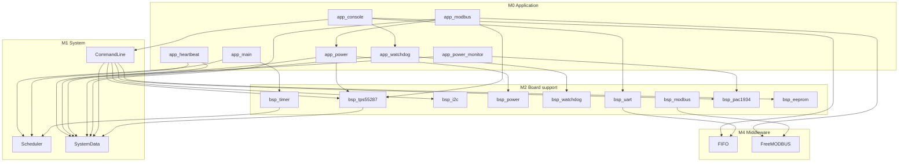
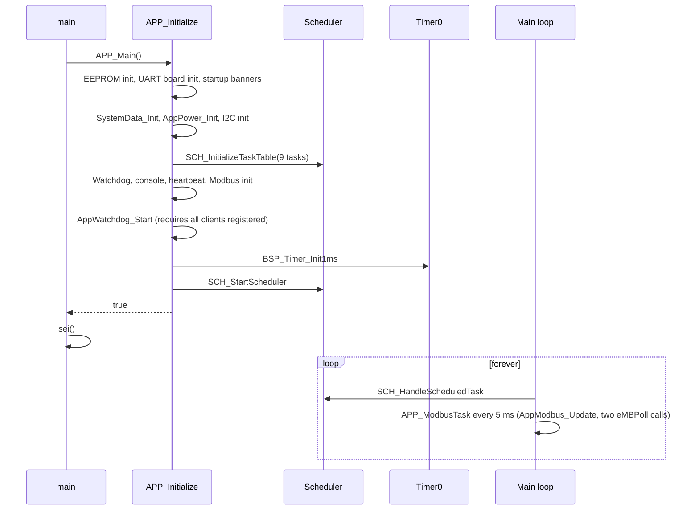
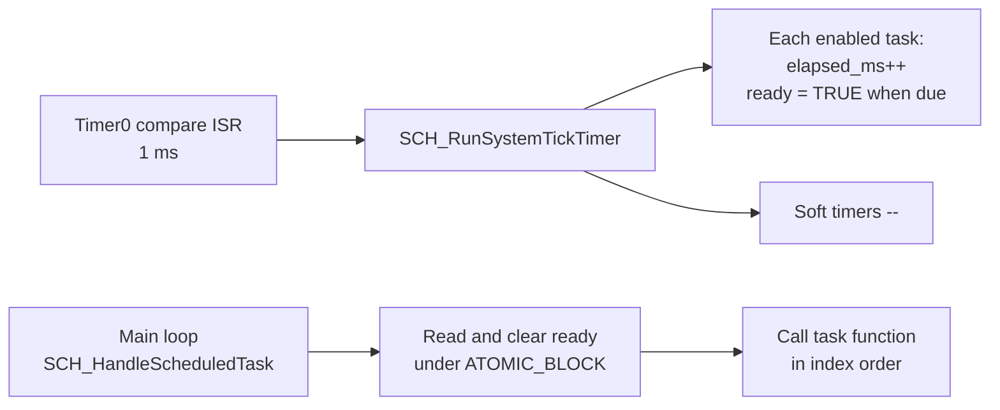
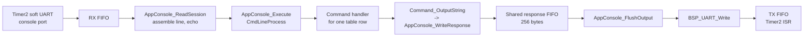
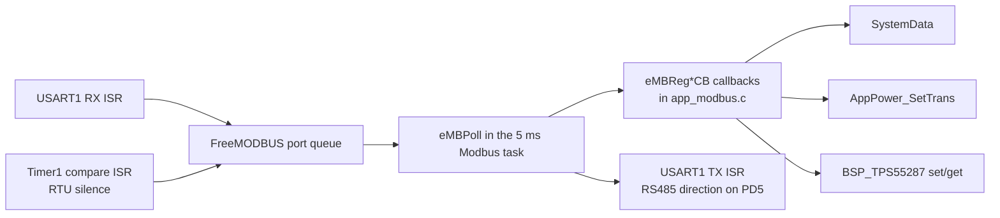
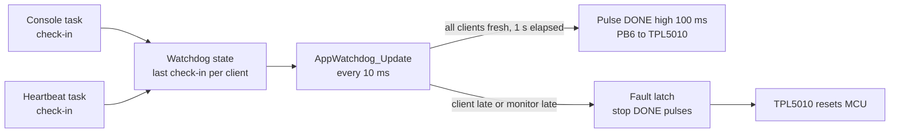

# Code architecture

This page describes how the current DAL_PDU firmware is layered, how data moves between
modules, and which tasks own which state. It describes the code under
`PDU/firmware/DAL_PDU/DAL_PDU/`. For the short overview see
[Current firmware architecture](current_firmware.md); for the scheduler internals see
[Scheduler design](scheduler_design.md).

## 1. Layers

The source tree is organised in six numbered layers. Lower numbers are closer to the
application; the `M` prefix is only a directory convention, not a build boundary.

| Layer | Path | Contents | Depends on |
|---|---|---|---|
| M0 Application | `src/dev/M0_App/` | Startup (`app_main`), console, heartbeat LED, power/TRANS, power monitor, watchdog supervision, Modbus register callbacks | M1, M2, M4 |
| M1 System | `src/dev/M1_Sys/` | `Scheduler` (task and soft-timer service), `CommandLine` (parser, command table, command handlers), `SystemData` (shared status records) | M2, M4 |
| M2 Board support | `src/dev/M2_BSP/` | Pin map (`dal_pdu_board.h`), UART ownership, timer ISR, I2C, power GPIO, watchdog pins, LED, Modbus port, TPS55287/PAC1934/24C04 board bindings | M3, M4 |
| M3 Driver | `src/dev/M3_Driver/` | `Component/` holds the AVR UART, software UART, I2C, and GPIO drivers. `Devices/` holds the TPS55287, PAC1934, and 24C04 chip drivers | M4, AVR headers |
| M4 Middleware | `src/dev/M4_MiddleWare/` | Byte FIFO, printf hook, FreeMODBUS (submodule) | AVR headers only |

### 1.1 Dependency rules as implemented

The intended direction is strictly downward. The code does not fully keep that promise:

| Observed dependency | Where | Assessment |
|---|---|---|
| M0 calls M2 directly (power GPIO, TPS55287, PAC1934, watchdog pins) | `app_power.c`, `app_modbus.c`, `app_power_monitor.c`, `app_watchdog.c` | Expected. M0 is the only caller that sequences the board. |
| M1 command handlers call M2 BSP | `command_tps55287.c`, `command_pac1934.c`, `command_i2c.c`, `command_eeprom.c` | Expected for maintenance commands, but it means host tests must mock BSP. |
| M2 owns the TPS55287 record | `bsp_tps55287.c` keeps `BSP_TPS55287_Status`, read by M0 and M1 through `BSP_TPS55287_GetStatus()` | Resolved 2026-10-06. M2 no longer writes into M1. The record is no longer in `SystemData`. |
| M0 Modbus callbacks call M0 `app_power` and M1 `SystemData` | `app_modbus.c` | Expected; both are in the application layer. |

Shared state lives in exactly one place. Most of it is in `SystemData`. The TPS55287 record is in its
BSP module, which is the only writer. Commands, tasks, and Modbus callbacks read these records.
No layer keeps a second copy of the same fact.

## 2. Module dependency view

## 3. Startup sequence

`main()` calls `APP_Main()`. Initialization runs with interrupts disabled. Interrupts are enabled
only after the scheduler has its task table and Timer0 is running.

If any step fails, `APP_Initialize` closes the UARTs and stops the scheduler, and most failure branches
also call `BSP_Watchdog_Inhibit()`. `APP_Main` then spins with interrupts disabled. The external TPL5010 watchdog is then the only
recovery path, which resets the MCU and retries startup.

## 4. Task inventory

These nine tasks are the scheduled work. Dispatch order is table index order, from
`app_main.c`. All run from the main loop, never from an ISR.

| Index | Task | Period | First run (phase) | Reads | Writes |
|---:|---|---:|---:|---|---|
| 0 | `AppConsole_Run` | 10 ms | 0 ms | UART0 XTP and software-console RX FIFOs | XCLI ping/reboot, local text commands, TX FIFOs, watchdog check-in |
| 1 | `AppHeartbeat_Update` | 20 ms | 0 ms | Operating mode, `SystemData` heartbeat timing and enable | LED pattern for the mode, soft timer `SCH_TIM_LED`, watchdog check-in |
| 2 | `AppPower_Update` | 6 ms | 3 ms | PC4 and PC0 fault inputs, TRANS state | Debounced fault latch and `SystemData` power status; eFuse FLT does not cause a software output shutdown |
| 3 | `AppPowerMonitor_Update` | 1000 ms | 950 ms | PAC1934 snapshot | `SystemData` power monitor status and limit checks |
| 4 | `AppRetry_Update` | 100 ms | 0 ms | Mode, retry configuration, regulator and live limits | Recovery attempt after ERROR outside MANUAL; restores saved output request on success |
| 5 | `AppWatchdog_Update` | 10 ms | 0 ms | Client check-in times and last DONE pulse time | DONE pin (PB6) every 1 s while healthy; fault latch |
| 6 | `AppTemperature_Update` | 1000 ms | 950 ms | ADC channel 1 (PF1) through `BSP_NTC_ReadTenthsC` | `SystemData` temperature status and limit check |
| 7 | `APP_ModbusTask` (`AppModbus_Update`) | 5 ms | 0 ms | USART1 RX frame and event queue, `SystemData` and TPS55287 records through the Modbus callbacks | `eMBPoll` replies, watchdog check-in |
| 8 | `APP_ClockTask` | 1000 ms | 950 ms | Scheduler tick | Software clock and periodic EEPROM checkpoint |

The 6 ms power task and the 10 ms console task are not synchronized; the 3 ms phase keeps the first
power check away from the first console pass.

The Modbus task calls `eMBPoll()` twice per run to service the USART1 RX/TX event queue and
callbacks. The callbacks read and write `SystemData` and control TRANS and the TPS55287.
Outside the task table, the `printf` hook `_putchar` writes into the active console response
owner when one is set.

## 5. Data flows

### 5.1 Tick to task

The ISR never calls a task. It only sets `ready`. A task that is due twice before it runs runs once
(see [Scheduler design](scheduler_design.md#6-coalescing)).

### 5.2 Console command

The software console owns the text response FIFO while a command runs. `help` streams one
table entry per pass through `Command_ContinueOutput`, so the 256-byte FIFO can drain.
USART0 is handled separately by `AppXtp_Run`, which parses XTP and handles XCLI ping/reboot.

### 5.3 Modbus request

### 5.4 Power fault response

1. `AppPower_Update` samples PC4 and PC0 every 6 ms. A fault held active for 50 ms is latched in internal EEPROM and raises WARNING. The eFuse FLT does not cause a software output shutdown or block TRANS enable.
2. A regulator failure or a limit trip in NORMAL raises ERROR. Outside MANUAL, VOUT is disabled before TRANS. The prior VOUT request is saved in RAM for recovery.
3. `AppRetry_Update` runs every 100 ms. When enabled, it waits the configured interval after ERROR, then checks the regulator and live limits. On success it enables TRANS and restores the saved VOUT request; on failure it leaves ERROR set for another interval. MANUAL suspends automatic retry. Console `mode retry` and Modbus `40030` = 4 request an immediate attempt.
4. `SystemData` publishes the resulting power status for console and Modbus readers.

The mode (NORMAL, MANUAL, WARNING, or ERROR) is derived from the self-test, the fault latch, the manual request, and the PAC1934 status. See [Mode state machine](mode_state_machine.md).

### 5.5 Telemetry

`AppPowerMonitor_Update` runs once per second. It calls `BSP_PAC1934_ReadSnapshot` and writes voltage,
current, and power for four channels. The `pac1934` console command reads the record, and does not
trigger a fresh conversion itself. The TPS55287 record is refreshed by BSP calls in the command and
Modbus paths, not by a periodic task. It lives in M2, so it is read through `BSP_TPS55287_GetStatus()`.

### 5.6 Watchdog handshake

The console, heartbeat, and Modbus clients use a 200 ms timeout; the two 1 s telemetry clients
use a 1500 ms timeout. The monitor timeout is 200 ms. The watchdog does not read PB5 WAKE.
A fault latch is permanent until reset.

## 6. Shared state and who touches it

| State | Owner | Writers | Readers | Concurrency rule |
|---|---|---|---|---|
| `SystemData` heartbeat, power, PAC1934, temperature records | M1 `SystemData` | Main-loop tasks, command handlers, Modbus callbacks | Main-loop tasks, commands, Modbus | No ISR touches these records. Single-context access. |
| TPS55287 record | M2 `bsp_tps55287.c` | The TPS55287 BSP calls, on the main loop | Main loop, command handlers, Modbus callbacks, `AppSetpoint_Update` through `BSP_TPS55287_GetStatus()` | Written only from the main loop. Single-context access. |
| Software clock | M0 `app_clock` | Main loop: `time`, Modbus callbacks (`40040`–`40041`), the event log, and a 1 s task that writes the 15-minute checkpoint | Main loop | Written only from the main loop. `SCH_SystemTick` supplies the elapsed time. Checkpoints go to internal EEPROM at 110–151 (a ring of 8). |
| Scheduler task table | M1 Scheduler | `SCH_RunSystemTickTimer` (ISR): `elapsed_ms`, `ready`. Main loop: `enabled`, `ready` cleared, and period changes | `SCH_HandleScheduledTask` | Main-loop writes use `ATOMIC_BLOCK`. ISR writes rely on the ISR being the only writer of `elapsed_ms` and `ready` set. |
| Scheduler soft timers | M1 Scheduler | Main loop (`SCH_TIM_Start`) and ISR (decrement) | Main loop (`SCH_TIM_isCompleted`) | Start and read are atomic. Decrement is ISR-only. |
| UART and console FIFOs | M4 FIFO, M2 UART | UART ISRs, Timer2 ISR, and main-loop writes | Main loop, ISRs | `fifo.h` states that `Push`, `Pop`, `Count`, and `Clear` are atomic on AVR. The response spool is used only from the main loop. |
| Console response spool and session state | M0 `app_console` | Main loop only | Main loop only | No ISR access. |
| Modbus port state | FreeMODBUS | USART1 and Timer1 ISRs, then `eMBPoll` in the 5 ms Modbus task | `eMBPoll` | Standard FreeMODBUS port contract. |

Everything an ISR touches is either a `volatile` scalar, an atomically-read counter, or a FIFO
designed for one producer and one consumer. The main loop owns all application state.

## 7. Known gaps in the architecture

- **Priorities.** Tasks run in table order. A long task delays every later task in the same pass.
  Nothing measures execution time. See the [scheduler design](scheduler_design.md#9-risks-and-limits).
- **Layer inversion: resolved.** `bsp_tps55287.c` owns its record, so M2 no longer calls into M1.
  The record is read through `BSP_TPS55287_GetStatus()`. The other records are still written by M0
  modules, which is the expected direction.
- **Command and BSP coupling.** Command handlers call BSP directly, so the command tests need the
  BSP mocked. This is acceptable for maintenance commands but not for future user-facing commands.
- **Duplicate overview.** [Current firmware architecture](current_firmware.md) and this page cover
  the same layers. Keep the overview short and point it here for detail.
