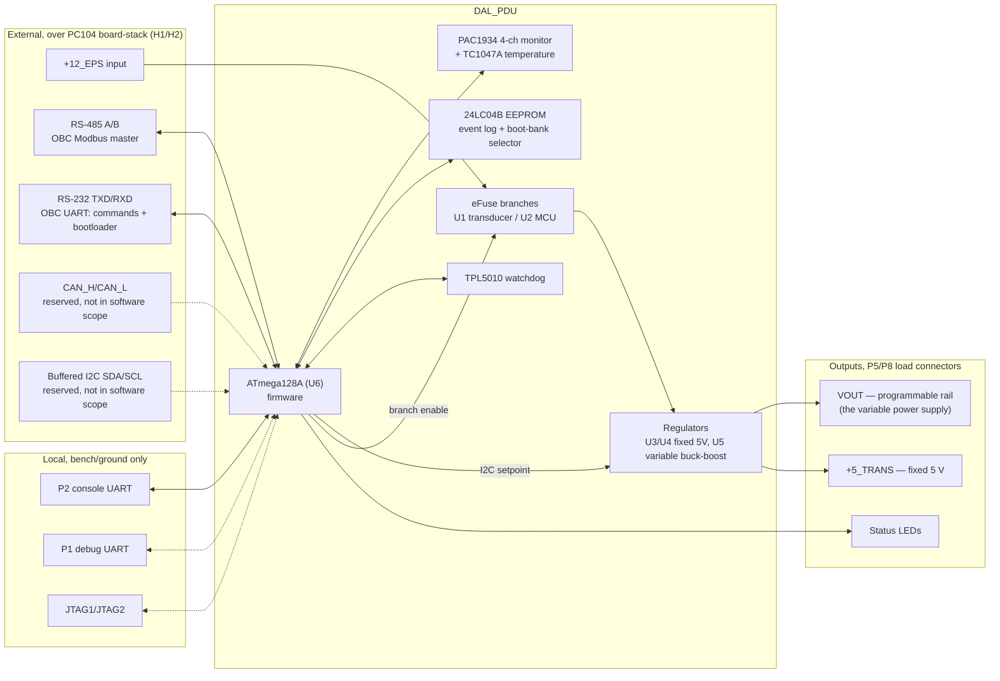
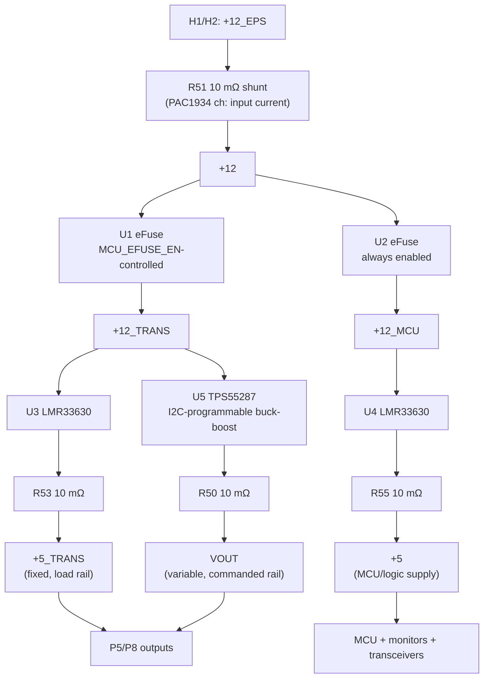

# Hardware overview

Source: hardware review at `DAL\REVIEW\review_dal_pdu_docs\docs` (schematic rev 1.1.0, BOM
`DAL_PDU_V1.0.xlsx`). This page restates the parts of that review firmware needs, plus the software-facing
interpretation (which pin drives what, which channel carries which protocol). It does not repeat every
BOM/layout finding — see the review package for the full issue register.

## System block diagram — inputs and outputs

`CAN` and the buffered PC104 `I2C` bus are populated and electrically valid data paths per the review,
but neither is in scope for this software design phase; they are shown as reserved.

## Power tree

**Firmware-relevant consequence:** the MCU's own 5 V logic supply (`+12_MCU` → U4 → `+5`) and the
transducer branch (`+12_TRANS` → U1/U3/U5) share the same upstream `+12` rail but are independently
eFuse-protected. `U1` (transducer branch) is the only branch the MCU can switch off
(`MCU_EFUSE_EN` → Q1 → U1 EN/UVLO); `U2` (MCU's own branch) is always-enabled by its divider, so firmware
cannot power itself off — good for keeping the MCU alive to service a fault, but it means a fault that
trips `U1` does not remove power from the MCU's own supervisory logic.

## Controllable / monitorable elements

| Element | Device | Firmware access | Role |
|---|---|---|---|
| Variable output voltage | U5 TPS55287 | I2C (shared TWI bus, PD0/PD1) | The commanded "variable power supply" rail (`VOUT`) |
| Transducer branch enable | U1 TPS259470 | GPIO `MCU_EFUSE_EN` → Q1 | Switches `+12_TRANS` (and everything downstream: U3, U5) on/off |
| MCU branch status | U2 TPS259470 | Fault flag only (`EFUSE2_MCU_FLT`) | Always-on; not switchable by firmware |
| Rail telemetry (V + I, 4 channels) | U10 PAC1934 | I2C (shared TWI bus) | `VOUT`, `+12` input, `+5_TRANS`, `+5` — voltage and current each |
| eFuse fault flags | U1/U2 `..._MCU_FLT` | GPIO input, pulled up to +5. PC4 is the U1 (12V TRANS) flag and PC0 is the U2 (12V_MCU) flag. | Overcurrent/fault latch per branch |
| PAC1934 alert | U10 PAC1934 | `PE7` (`MCU_PAC1934_INT`) | Not used. The firmware polls the PAC1934 each second. |
| Board temperature | U11 TC1047A | ADC, `PF1`/`ADC1` (confirmed) | Analog voltage proportional to temperature |
| Event log / boot-bank selector | U14 24LC04B EEPROM | I2C (shared TWI bus) | Boot-bank pointer, calibration, event log. The Modbus address and baud are in the ATmega128A internal EEPROM (OI-11). |
| Watchdog service | U13 TPL5010-Q1 | GPIO `WAKE` in on PB5, `DONE` out on PB6, `RSTn` reset | External hardware watchdog independent of the MCU's own timers |

## MCU serial resource map (as wired today)

The ATmega128A has exactly **two hardware USARTs**: `USART0` (PE0/PE1) and `USART1` (PD2/PD3). The
schematic assigns three serial roles across four different pin pairs, only one of which lands on a real
USART:

| Net / role | Connector | MCU pins | Hardware peripheral | Status |
|---|---|---|---|---|
| PC104 UART (OBC commands + bootloader) | H1-19/H1-20 via U12 SN65C3232 | PE0/PE1 | `USART0` — real hardware UART | Wiring valid; **U12 driver/receiver direction is reversed (`IF-001`, blocker)** |
| Local console | P2 | PE3/PE4 | `OC3A`/`AIN1`, `OC3B`/`INT4` — **not a USART** | Mislabeled net; **not realizable as hardware UART (`MCU-001`, blocker)** |
| RS-485 (Modbus to OBC) | H1-37/H1-38 via U9 MAX485 | USART1: PD2 (RX) / PD3 (TX); PD5 (DIR), confirmed on the board | Hardware USART1 | Firmware uses the hardware UART. The review schematic (rev 1.1.0) still shows PD4/PD5/PD6, so it must be updated. The board uses PD2 (RX), PD3 (TX), and PD5 (DIR), confirmed 2026-10-06. |
| Debug UART | P1 | shares `USART0` logic | `USART0` | Conflicts with the PC104 UART path until `IF-001` is resolved; bench/ground use only |
| — unused — | — | PD2/PD3 | `USART1` — real hardware UART, currently unassigned | Spare hardware UART |

This shapes the whole communications design — see
[Serial resource allocation](software_requirements.md#41-serial-resource-allocation) for how the three
required channels (PC104 UART, console, Modbus/RS-485) are assigned to these pins, and why.

## Connector I/O relevant to firmware

| Connector | Pins | Signal | Direction (at PDU) | Used for |
|---|---|---|---|---|
| H1 | 1, 3 | `CAN_L`, `CAN_H` | Bidirectional | Reserved, not in software scope |
| H1 | 19, 20 | `TXD_RS232`, `RXD_RS232` | Intended out/in (currently reversed, `IF-001`) | PC104 UART: commands + bootloader |
| H1 | 37, 38 | `RS485_B`, `RS485_A` | Bidirectional | Modbus RTU to/from OBC |
| H1 | 44, 46 | `PC104_I2C_SDA/SCL` (buffered) | Bidirectional | Reserved, not in software scope |
| H1 | 45 | `MCU_I2C_IRQ2` | Input | Reserved |
| H1/H2 | per sheet 14 | `+12_EPS`, `+5`, PGND | Power in/out | Board-stack power; exact pin list needs the native netlist (`CON-001`) |
| P2 | 4-pin | `+5`, `CONSOLE_MCU_RX`, `MCU_CONSOLE_TX`, PGND | Local UART | Console (bench/ground) |
| P1 | 4-pin | `+5`, `RS232_MCU_RX`, `MCU_RS232_TX`, PGND | Local UART | Debug (bench/ground) |
| P5/P8 | — | `VOUT`, `+5_TRANS`, PGND/shield | Output | Load outputs |
| JTAG1/JTAG2 | 4-pin ea. | TDO/TCK/TDI/TMS/RESET | Programming | In-circuit programming during bring-up |

Per the review, `H1`/`H2` are drawn as 50-pin symbols against a 52-contact BOM part (`CON-001`), and
several connectors (`P2`, `P3`, `P5`, `P6`, `P8`, `P9`, JTAG headers) have no confirmed BOM line or mate
(`CON-002`). Firmware only depends on the signal-level assignments above, not on the mechanical connector
resolution, but final connector pinout must be confirmed against the native netlist before harness/cable
design.

## Known hardware issues that gate firmware bring-up

| ID | Severity | Status | Finding | Why firmware cares |
|---|---|---|---|---|
| `MCU-001` | Blocker | Decided: software UART (`OI-30`) | Console TX/RX are on `PE3`/`PE4`, not a USART pair | The console is a software UART on those pins. |
| `IF-001` | Blocker | Open | RS-232 driver/receiver direction reversed at U12 | PC104 UART (commands + bootloader image transfer) does not function electrically until fixed |
| `BOM-001` | Blocker | Open | BOM systematically disagrees with schematic | Regenerate the BOM from the schematic, then compare it with the firmware assumptions in the A-2 row |
| `BOM-002` | Blocker | Decided: 12 MHz | The board uses a 12 MHz crystal. The schematic still shows 16 MHz | Firmware `F_CPU` is 12 MHz. The schematic and BOM must follow |
| `BOM-003` | Blocker | Open | BOM can install near-shorts where the schematic needs pull-ups or shunts | Resistor values must match the schematic before bring-up |
| `I2C-001` | Major | Confirmed: 4.7 kΩ | SDA/SCL pull-ups are 4.7 kΩ as fitted | Meets the I2C timing the firmware assumes. Fit the BOM to match |
| `MCU-002` | Major | Confirmed | Reset network is 10 kΩ / 0.1 µF | Reset timing is about 1 ms, which keeps the boot-cause logic correct |
| `IF-002` | Major | Accepted as-is (`A-3`) | RS-485 idle-bias differential is about 30 mV | Modbus framing must tolerate idle noise (`SRS-COM-030`) |
| `PWR-002` | Major | Partly decided | No worst-case budget is documented. The overcurrent default is now 1 A | The 1 A default is set. Confirm it against the eFuse ILIM values on the bench |
| `PWR-004` | Minor | Unused by decision | U3/U4 `PG` (power-good) pins are not routed to the MCU | Rail health comes from PAC1934 readings (`A-5`) |
| `MON-001` | Minor | Decided: 5 % | PAC1934 accuracy | The readback tolerance (OI-06) is also 5 %, so it stays consistent |
| `OI-29` | Blocker | Resolved | Pins confirmed: PC4 is the 12 V TRANS fault, PC0 the 12 V_MCU fault, WAKE is PB5. The PAC1934 INT is on PE7 (not used by firmware) | The firmware pins match the board |

Full detail, calculations, and the remaining open items (connector mating, ESD/surge protection, layout
evidence) live in the review package's issue register at
`DAL\REVIEW\review_dal_pdu_docs\docs\issue_register.md` (outside this mkdocs site, since it belongs to a
separate hardware-review project).
