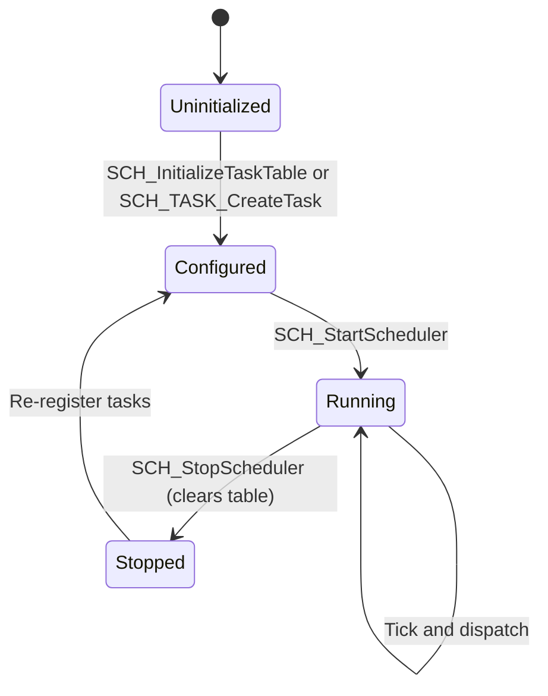
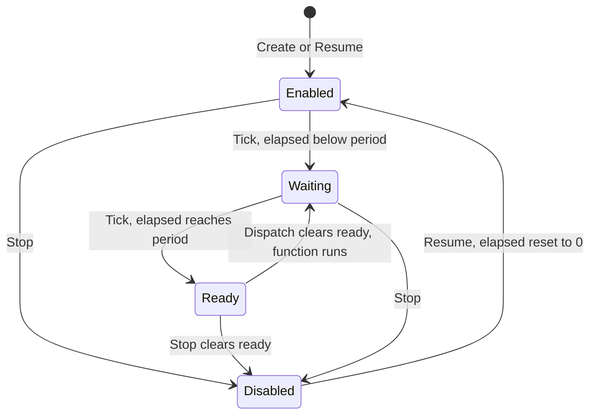

# Scheduler design

This page documents the scheduler in `PDU/firmware/DAL_PDU/DAL_PDU/src/dev/M1_Sys/Scheduler/`
(`scheduler.c`, `scheduler.h`, `scheduler_define.h`) as it exists today. It covers the model, the
data each task carries, the rules for which context may touch which field, the timing it gives, and
its known limits. The code architecture around it is in [Code architecture](code_architecture.md).

## 1. Model

The scheduler is a **per-task-period, non-preemptive dispatcher**:

- A 1 ms tick, driven by Timer0's compare interrupt, advances every registered task's own counter.
- When a counter reaches the task's period, the task is marked **ready**. The tick never runs the task.
- The main loop calls `SCH_HandleScheduledTask()`. That call runs every ready task once, in table index order.
- Each task has its own period, phase, and enable flag. Periods are not tied to a shared step grid.
- Tasks have **no priority**. Ordering is by table index only, and a running task is never preempted.

Both halves are needed: the tick decides what is due, the main loop decides when it runs.

The scheduler is not a cyclic executive. A cyclic executive derives each task's rate from a fixed step
table, so every rate is a multiple of one step. The trade-off is discussed in
[Design trade-offs](#10-design-trade-offs).

## 2. Configuration

| Symbol | Value | Where | Meaning |
|---|---|---|---|
| `MAX_TASKS` | 9 | `scheduler_define.h` | Size of the static task table. All nine application task slots are used. |
| `USE_SCH_SEMAPHORE` | not defined | `scheduler_define.h` | Enables the optional binary semaphore API and `MAX_SEMAPHORES` (2). |
| `SCH_SoftTimerTypedef` | `SCH_TIM_LED`, `SCH_TIM_WDT`, `SCH_TIM_LAST` | `scheduler_define.h` | Soft-timer slots. Add new slots before `SCH_TIM_LAST`. |
| Tick source | Timer0 compare, F_CPU / 64, OCR0 = 186 at 12 MHz | `bsp_timer.c` | 1.0027 ms at 12 MHz (0.27 % slow). Exactly 1 ms at 16 MHz. A compile-time `#error` rejects any `F_CPU` that gives a count outside 1 to 256. |

## 3. Public API

| Function | Context | Purpose |
|---|---|---|
| `SCH_Initialize()` | Init | Clear all state. Called by `SCH_InitializeTaskTable`. |
| `SCH_InitializeTaskTable(tasks, count)` | Init | Validate, then copy a fixed table of `SCH_TaskContext`. Returns `SCH_ERROR` on any bad entry. |
| `SCH_TASK_CreateTask(&handle, &property)` | Init or main | Register one task with a period. The property is copied. |
| `SCH_TASK_StopTask(handle)` | Main | Disable the task, clear ready, restart its count on resume. |
| `SCH_TASK_ResumeTask(handle)` | Main | Enable the task. The next run comes a full period later. |
| `SCH_TASK_SetPeriod(handle, ms)` | Main | Change the period and restart the count. Does not change enable state. |
| `SCH_StartScheduler()` | Init | Allow the tick to advance tasks and dispatch to run. |
| `SCH_StopScheduler()` | Main or init | Stop, and **clear the whole task table**. Previously returned handles become invalid. |
| `SCH_RunSystemTickTimer()` | Tick ISR only | Advance counters and soft timers. |
| `SCH_HandleScheduledTask()` | Main loop only | Run every ready, enabled task once. |
| `SCH_SystemTick()` | Any | Milliseconds since initialization, read atomically. Wraps after about 49.7 days. |
| `SCH_TIM_Start(timer, ms)` | Any | Load a soft timer countdown. |
| `SCH_TIM_isCompleted(timer)` | Any | TRUE when the countdown is zero. An out-of-range slot returns TRUE. |

### 3.1 Task descriptor

```c
typedef struct
{
    SCH_TASK function;          /* void (*)(void); must not be NULL */
    volatile uint16_t period_ms;   /* 1..65535 ms, counted in ticks */
    volatile uint16_t elapsed_ms;  /* ticks since the last ready or restart */
    volatile uint8_t  ready;       /* set by the tick ISR, cleared by dispatch */
    volatile uint8_t  enabled;     /* only enabled tasks count */
} SCH_TaskContext;
```

`SCH_InitializeTaskTable` rejects an entry with `period_ms == 0`, with `elapsed_ms >= period_ms`, or
with `ready` or `enabled` not equal to 0 or 1. That means the first run of a table entry happens after
`period_ms - elapsed_ms` ticks. The application's table in `app_main.c` uses this to put the power check
3 ms after startup, then every 6 ms.

## 4. Lifecycle



Each task has its own small state machine:



`SCH_TASK_SetPeriod` moves a task back to Waiting with elapsed reset to 0, and leaves Enabled or
Disabled unchanged.

## 5. Algorithms

### 5.1 Tick (ISR, every 1 ms)

```
if not running: return
system_tick += 1
for each task i in 0 .. task_count-1:
    if task[i].enabled:
        task[i].elapsed += 1
        if task[i].elapsed >= task[i].period:
            task[i].elapsed = 0
            task[i].ready = TRUE
for each soft timer t in 0 .. SCH_TIM_LAST-1:
    if timer[t] > 0: timer[t] -= 1
```

### 5.2 Dispatch (main loop)

```
if not running: return
for i = 0; i < task_count and running; i++:
    atomic:
        run = task[i].ready and task[i].enabled
        task[i].ready = FALSE
    if run and task[i].function != NULL:
        task[i].function()
```

`ready` is cleared before the function runs. If the tick sets it again during the function, the task
runs again on the next dispatch pass. A task cannot run twice in one pass, because the index only moves
forward.

### 5.3 Worked timing example

With the application table, the Timer0 tick is at t = 0, 1, 2, ... ms.

| Task | Period | Phase | Ready at | Dispatch at the earliest |
|---|---:|---:|---|---|
| Power | 6 ms | 3 ms | t = 3, 9, 15, ... | Next main-loop pass after each tick |
| Console | 10 ms | 0 ms | t = 10, 20, 30, ... | Next pass after each tick |
| Heartbeat | 20 ms | 0 ms | t = 20, 40, 60, ... | Next pass after each tick |
| Monitor | 1000 ms | 0 ms | t = 1000, 2000, ... | Next pass after each tick |
| Watchdog | 10 ms | 0 ms | t = 10, 20, 30, ... | Next pass after each tick |
| Temperature | 1000 ms | 0 ms | t = 1000, 2000, ... | Next pass after each tick |

If the main loop does not call dispatch for a while, a task that is ready when dispatch runs is
delayed by that gap. Its next ready time is not affected.

## 6. Coalescing

If a task's counter reaches its period again before dispatch runs, `ready` is already TRUE and stays
TRUE. The second due time is lost. One call to the function covers both.

This is intended. It keeps the main loop from being flooded when it falls behind. The cost is that
the scheduler does not record missed periods; there is no overrun counter.

## 7. Concurrency rules

| Field or operation | Written by | Read by | Protection |
|---|---|---|---|
| `s_SystemTick` | Tick ISR | Any context via `SCH_SystemTick` | Read inside `ATOMIC_BLOCK`. Written only from the tick ISR. |
| `elapsed` and `ready` | Tick ISR; main loop clears `ready` and resets `elapsed` on stop, resume, and period change | Dispatch | Main-loop writes are inside `ATOMIC_BLOCK`. Dispatch reads `ready` and clears it atomically. |
| `enabled` | Main loop only | Tick ISR and dispatch | Main-loop writes are inside `ATOMIC_BLOCK`. |
| Task table and `task_count` | Init or main loop | Tick ISR and dispatch | Init and stop writes are atomic. Creating a task from a task body is allowed (see below). |
| Soft timers | Main loop (start) and tick ISR (decrement) | Main loop | Start and read are atomic. Decrement is ISR-only. |

Only the tick ISR calls the scheduler from interrupt context. The UART, software UART, Modbus, and
Timer1 handlers never call it (checked across `M2_BSP` and `M3_Driver`). If that changes, the rule
above has to be revisited.

The timer ISR is declared with `ISR_NOBLOCK`. Other interrupts can therefore run while the tick is
updating counters. That is safe only because none of those other interrupts touch scheduler state.

A task body may call `SCH_TASK_CreateTask` during dispatch. Because the dispatch loop reads
`task_count` on every iteration, a task created at a higher index can run in the same pass. Keep
registration in init unless you need that behavior.

## 8. Soft timers

Soft timers are 32-bit millisecond countdowns, unrelated to the task table. The heartbeat task uses
`SCH_TIM_LED` for its ON and OFF phases. `SCH_TIM_WDT` is declared in `scheduler_define.h` but no module starts it. The watchdog module
measures its own intervals from `SCH_SystemTick` instead.

Starting a timer with `0` makes it complete immediately. An out-of-range slot reports completed, so a bad
index cannot block a caller.

## 9. Risks and limits

| # | Limit | Effect | Current mitigation |
|---|---|---|---|
| R1 | No priorities; a running task is not preempted | A long task delays all later tasks in the pass and the next pass. | Tasks are short by convention. Nothing enforces it. |
| R2 | No execution-time measurement | A slow task cannot be detected in the field. | None. Candidate for a debug-build timing hook. |
| R3 | Coalescing hides missed periods | Overload is invisible. | None. Candidate for an overrun counter per task. |
| R4 | Dispatch latency is not bounded by the scheduler | Worst-case delay is 1 ms tick plus the longest main-loop pass, including `eMBPoll` and any task body. | Not measured. Needs a worst-case budget per pass. |
| R5 | `SCH_StopScheduler` clears the whole table | Old handles become invalid. Restarting without re-registering runs nothing. | Stop is only called on init failure today. |
| R6 | Init failure spins with interrupts off | No logging. Recovery depends on the external TPL5010 reset. | Intentional. Documented in [Code architecture](code_architecture.md#3-startup-sequence). |
| R7 | 49.7-day wrap of `SCH_SystemTick` | Direct comparisons break after about 50 days of uptime. | Callers use unsigned subtraction. The watchdog module does. |
| R8 | 16-bit period and elapsed counters | Maximum period is 65535 ms, about 65 s. | `SCH_TASK_CreateTask` and `SetPeriod` reject 0. Larger periods are not supported. |

R4 is the one that matters most for the watchdog. The TPL5010 is serviced from a 10 ms task. If a
pass runs longer than the watchdog's 200 ms client and monitor timeouts, the application watchdog
latches a fault and stops the DONE pulses. Measure the worst-case pass on hardware before relying on
that margin.

## 10. Design trade-offs

These are the trade-offs against a fixed cyclic executive, the model used by the AL020004 reference
(PIC18, Microchip C18) that was reviewed during design.

| Property | Current per-period scheduler | Cyclic executive |
|---|---|---|
| Rate of each task | Any value in ms, independent per task | Multiple of the step period, fixed by step membership |
| Changing a rate | Call `SCH_TASK_SetPeriod` | Edit the step masks and rebuild |
| Dispatch order | Table index, no priority | Fixed by bit position within a step |
| Schedule analysis | Needs per-pass worst-case budgeting | The whole schedule can be read off one table |
| Runtime control | Stop, resume, and change period | None |
| Missed deadline visibility | Hidden by coalescing | Visible as a skipped step |
| Failure containment | Watchdog and fault latch in the app layer | Same, plus a static proof of watchdog service interval |

The current scheduler was chosen for runtime flexibility. Its weakest point for a safety argument is R4:
the worst-case pass length has to be measured and documented, not inferred from the table. Adding an
overrun counter (R3) and a per-pass timing hook (R2) would close most of the gap without changing the model.

## 11. Verification

`make -C PDU/tests test` runs the scheduler under the host harness in both configurations
(`test_scheduler.exe` and `test_scheduler_semaphore.exe`). The suite checks tick and timer behavior,
lifecycle, semaphores, per-task periods, stop and resume, period changes, capacity, and pending flag
coalescing. The app startup test checks the 10, 20, and 6 ms task periods and Timer0 setup.

The host build uses a single-threaded `atomic.h` shim. It does not check interrupt safety, nested ISR
behavior, or the timing in R4. Those need bench measurement on the board.
