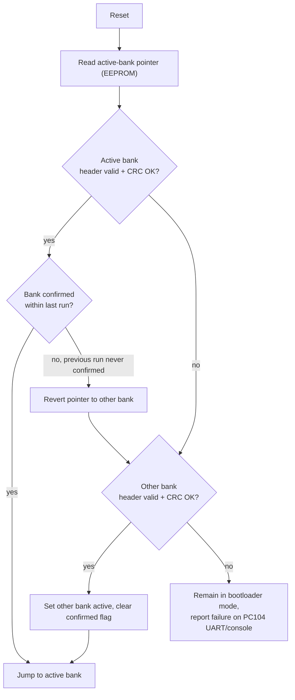

# Software requirements document

## 1. Scope

This document defines the requirements for the DAL_PDU firmware (ATmega128A, `U6`). The firmware turns
the board into an OBC-commanded variable power supply: it regulates and reports the `VOUT` rail, switches
the transducer branch, reports telemetry, accepts commands over Modbus (RS-485), a PC104 UART, and a
local console UART, and hosts a dual-bank, CRC-checked bootloader that the OBC can use to reflash the
board over the PC104 UART. Hardware facts referenced here come from
[Hardware overview](hardware_overview.md); see that page for the underlying schematic evidence.

Requirement IDs use the prefix `SRS-<AREA>-<NNN>`. `AREA` is one of `GEN` (general), `PWR` (power
control), `PROT` (protection), `MON` (monitoring), `COM` (communications), `BOOT` (bootloader), `WDT`
(watchdog), `CFG` (configuration/NVM).

## 2. Assumptions and hardware dependencies

| ID | Assumption | Consequence if false |
|---|---|---|
| `A-1` | `IF-001` (RS-232 driver/receiver direction at U12) is corrected before firmware bring-up. The console uses the software UART on PE3/PE4 (`MCU-001`, decided). | Section 4.1's allocation of USART0 to the PC104 UART is valid once `IF-001` is fixed. The PC104 UART and bootloader cannot function until then. |
| `A-2` | The crystal is 12 MHz and the I2C pull-ups are 4.7 kΩ, as fitted (`BOM-002`, `I2C-001`, decided 2026-10-06). The BOM and schematic are brought into line with this (`BOM-001`, `BOM-003`). | Baud-rate, I2C, ADC, and timer calculations use `F_CPU` = 12 MHz in `dal_pdu_board.h`. The Timer0 tick is 1.0027 ms (0.27 % slow). Baud errors are 0.16 % or less. |
| `A-3` | `IF-002` (RS-485 idle bias about 30 mV) is accepted as-is (decided 2026-10-06). | Modbus framing must tolerate line noise during idle and undriven bus periods (`SRS-COM-030`). |
| `A-4` | Firmware uses the TPS55287 internal feedback setting (`VOUT_FS = 0x03`) and the 800–20000 mV range. Earlier hardware notes identify a populated external divider (R22/R30); bench verification is needed to confirm the built board operates correctly with internal feedback. | `VOUT` setpoint accuracy and maximum remain subject to board measurement. |
| `A-5` | No hardware power-good signal is used for the fixed 5 V rails. The PG outputs are unused by decision (`PWR-004`). | Rail-health inference relies entirely on PAC1934 readings, not a GPIO power-good interrupt |

## 3. System modes

The operating mode is one of four: **NORMAL**, **MANUAL**, **WARNING**, and **ERROR**. The mode is derived from
the self-test, the fault latch, the manual request, and the PAC1934 status. The implementation is described in
[Mode state machine](mode_state_machine.md).

```mermaid
stateDiagram-v2
  [*] --> NORMAL: startup, no error
  [*] --> WARNING: PAC1934 U10 not detected
  NORMAL --> WARNING: PAC1934 unreadable or link lost
  NORMAL --> ERROR: over-temperature or overcurrent limit
  WARNING --> NORMAL: cause clears
  NORMAL --> ERROR: regulator not detected when TRANS is enabled, fault, or no response
  WARNING --> ERROR: regulator not detected when TRANS is enabled, fault, or no response
  NORMAL --> MANUAL: manual request
  WARNING --> MANUAL: manual request
  ERROR --> MANUAL: manual request
  MANUAL --> NORMAL: normal request, regulator responds and no limit is exceeded
  ERROR --> NORMAL: normal request, healthy regulator and limits
  ERROR --> WARNING: normal request, healthy regulator and limits; warning cause present
  ERROR --> NORMAL: retry, healthy regulator and limits
  ERROR --> WARNING: retry, healthy regulator and limits; warning cause present
```

The regulator (U5) is behind the TRANS eFuse, which is off at idle by design, so it is checked on demand the
first time TRANS is enabled, not at startup (OI-31) — the `[*] --> ERROR` transition that used to exist here
for a missing regulator at startup is gone for that reason.

- **NORMAL**: outputs allowed, as commanded. The regulator is monitored every second. A regulator fault, or an over-temperature or overcurrent limit trip, moves the unit to ERROR.
- **MANUAL**: entered by command from NORMAL, WARNING, or ERROR. Regulator and limit causes leave outputs under operator control. A normal request checks those causes before leaving MANUAL.
- **WARNING**: entered when an eFuse FLT is confirmed, the PAC1934 is unreadable, or Modbus link loss is active. These causes do not turn outputs off in software.
- **ERROR**: entered for a regulator fault or a limit trip in NORMAL. Outputs are forced off. A healthy normal request, fault clear, or retry clears regulator/limit causes. Automatic retry defaults to every 5 s outside MANUAL.
- **Self-test** (startup only): U10 missing gives WARNING, and U14 (24C04) missing is recorded but does not change the mode. U5 is not part of the startup self-test (OI-31) — it is checked on demand the first time TRANS is enabled.
- **Bootloader**: not yet implemented (see [Open issues OI-16](open_issues.md)). When implemented, `VOUT` and the transducer branch are forced off before entry (`SRS-BOOT-076`).

## 4. Functional requirements

### 4.1 Serial resource allocation

The MCU has two hardware USARTs and three required serial roles (Section 3 of
[Hardware overview](hardware_overview.md#mcu-serial-resource-map-as-wired-today)). This design allocates
them by criticality: the OBC-facing Modbus link is the primary real-time control channel and gets a
hardware UART even though it is not the one silk-screened for it; the human-operated console tolerates a
software UART's jitter.

| Requirement | Statement |
|---|---|
| `SRS-COM-001` | The PC104 UART (commands + bootloader, `H1-19/20` via U12) **shall** use `USART0` (`PE0`/`PE1`), once `IF-001` is corrected. No pin change required. |
| `SRS-COM-002` | The Modbus/RS-485 link **shall** use `USART1`: MCU RX on `PD2`, MCU TX on `PD3`, and the RS-485 direction on `PD5`, as wired on the board (ECO confirmed 2026-10-06). |
| `SRS-COM-003` | Superseded by `SRS-COM-002`. The ECO is on the board, so the bit-banged Modbus fallback is not used. |
| `SRS-COM-004` | The local console (`P2`, `MCU_CONSOLE_TX/RX` on `PE3`/`PE4`) **shall** be implemented as a timer-driven, bit-banged UART on those existing pins, since they are not a hardware USART pair (`MCU-001`) and the console is human-typed, low-duty, and non-real-time. |
| `SRS-COM-030` | With the RS-485 idle bias at about 30 mV (`A-3`), the firmware **shall** accept a request only when its frame is complete (T3.5 silence), its address matches, and its CRC is valid. Bytes that do not form a valid frame **shall** be discarded without a reply. |
| `SRS-COM-005` | The debug UART (`P1`, sharing `USART0` logic) **shall** be bench/ground-only and **shall not** be active at the same time as the PC104 UART in a flight/operational configuration. |

### 4.2 Power control (variable output)

| Requirement | Statement |
|---|---|
| `SRS-PWR-010` | Firmware **shall** command the `VOUT` setpoint by writing the U5 TPS55287 output-voltage register over the shared I2C/TWI bus (`PD0`/`PD1`). |
| `SRS-PWR-011` | Firmware **shall** default `VOUT` and the transducer branch (`U1`) to disabled at power-up, until commanded otherwise. |
| `SRS-PWR-012` | Firmware **shall** enable the transducer branch (`U1` via `MCU_EFUSE_EN`/Q1) before enabling `VOUT`, and **shall** disable `VOUT` before disabling the transducer branch, on every transition. |
| `SRS-PWR-013` | Firmware **shall** select and verify internal feedback on the 20 V scale (`0x04 = 0x03`) before calculating a setpoint or enabling VOUT, and reject setpoints outside 800–20000 mV rather than clamping silently. VOUT enable **shall** require a setpoint programmed since TPS detection. If VOUT is enabled in another feedback mode, it **shall** be disabled before correction and its reference reprogrammed before re-enabling. The range remains subject to bench calibration (Assumption `A-4`). |
| `SRS-PWR-014` | Firmware **shall** confirm the applied `VOUT` setpoint by reading back the PAC1934 `VOUT` channel within a bounded settling time and flag a setpoint-mismatch condition if the measured value does not converge. |
| `SRS-PWR-015` | Firmware **shall not** enable `VOUT` or the transducer branch in ERROR unless MANUAL has been requested, in which case MANUAL takes priority. An eFuse FLT latch is a WARNING and **shall not** block the transducer branch. VOUT enable still requires a responding TPS55287 with verified internal feedback. Bootloader gating remains required (Section 3). |

### 4.3 Protection

| Requirement | Statement |
|---|---|
| `SRS-PROT-020` | Firmware **shall** sample `EFUSE1_MCU_FLT` and `EFUSE2_MCU_FLT` every 6 ms. Assertion **shall** be confirmed when active samples span at least 50 ms with no inactive sample observed. Once confirmed, it **shall** latch the fault (`SRS-PROT-023`) and enter WARNING without a software shutdown of `VOUT` or TRANS. The eFuse's hardware protection still applies. |
| `SRS-PROT-021` | In NORMAL mode, firmware **shall** monitor board temperature (`TC1047A`, `PF1`/ADC1) against an over-temperature limit (default 85.0 °C, set with the `limit` command and stored in internal EEPROM). After two consecutive samples at or above the limit, it **shall** turn `VOUT` and the transducer branch off and enter ERROR. In every mode, each trip **shall** be logged as a WARNING event (`SRS-MON-032`). |
| `SRS-PROT-022` | In NORMAL mode, firmware **shall** monitor PAC1934 current readings on the `VOUT` and `+5_TRANS` channels against limits (default 1000 mA each, set with the `limit` command and stored in internal EEPROM). After three consecutive samples above a limit, it **shall** turn `VOUT` and the transducer branch off and enter ERROR. In every mode, each trip **shall** be logged as a WARNING event (`SRS-MON-032`). The check is independent of the eFuse's own hardware current limit. |
| `SRS-PROT-023` | A latched fault **shall** remain latched until cleared by command: Modbus coil `00003` or the `fault clear` console command. The clear **shall** be refused while a fault input is still active. Firmware **shall not** auto-clear a latched fault. |
| `SRS-PROT-025` | The `fault clear all` console command **shall** recheck all reported fault causes, clear only causes whose conditions have recovered, and report when any cause remains. It **shall not** enable outputs or leave MANUAL mode. Acknowledging link loss **shall** restart, not disable, its timeout. |
| `SRS-PROT-024` | Because `U2` (MCU branch) cannot be switched off by firmware, a fault on the MCU branch itself **shall** be reported but **cannot** be remediated by firmware power-cycling itself; only telemetry/fault reporting applies. |
| `SRS-PROT-050` | When the regulator check fails, or a limit trips (`SRS-PROT-021`, `SRS-PROT-022`), outputs **shall** be off outside MANUAL. MANUAL takes priority and leaves outputs under operator control. A request for NORMAL or `fault clear` **shall** clear regulator/limit causes only after the regulator responds and no limit is exceeded. An eFuse latch is cleared by `fault clear` (`SRS-PROT-023`). The firmware **shall not** reset itself to clear ERROR. |
| `SRS-PROT-051` | Automatic retry **shall** default to enabled with a 5 s interval, configurable from 1 to 60 s. While ERROR persists outside MANUAL, each interval **shall** trigger a regulator and live-limit check. A successful check **shall** restore TRANS and a previously enabled VOUT at its saved setpoint when that request remains available in RAM; after reset, TRANS alone can be restored. A failed check **shall** leave ERROR set and wait another interval. `mode retry` and Modbus `40030` = 4 **shall** request an immediate attempt. Retry settings **shall** persist in internal EEPROM. |

### 4.4 Monitoring / telemetry

| Requirement | Statement |
|---|---|
| `SRS-MON-030` | Firmware **shall** poll all four PAC1934 channels (`VOUT`, `+12` input, `+5_TRANS`, `+5`) at a fixed background rate independent of communications activity. |
| `SRS-MON-031` | Firmware **shall** sample board temperature at a fixed background rate and make the latest reading available on every communications channel. |
| `SRS-MON-032` | Firmware **shall** keep a bounded persistent event log (a 32-slot ring in the 24C04) of fault, mode, and limit events, each stamped with the software clock (`SRS-MON-034`), retrievable via console and Modbus. |
| `SRS-MON-033` | Telemetry values **shall** be available (read-only) in every mode, including ERROR and WARNING, so a fault remains observable after it occurs. |
| `SRS-MON-034` | Firmware **shall** keep a software clock (UTC), set from the console (`time set`) or Modbus (`40040`–`40041`) and read from either. The clock **shall** store a checkpoint in internal EEPROM every 15 minutes and on each set, and **shall** restore the last checkpoint after a reset, marked as `RESTORED`. Each logged event **shall** carry the clock time and its source (`UNSET`, `RESTORED`, or `SET`). |

### 4.5 Communications (general)

| Requirement | Statement |
|---|---|
| `SRS-COM-040` | The Modbus interface **shall** implement a Modbus RTU slave per the register map in [Modbus RTU implementation](modbus_implementation.md). The design draft differences are in [Design differences](modbus_implementation.md#design-differences). |
| `SRS-COM-041` | The Modbus slave address **shall** be stored in non-volatile configuration (`SRS-CFG-061`) and take effect only after reboot. |
| `SRS-COM-042` | The PC104 UART **shall** implement the ASCII command set in [Use cases & commands](use_cases_commands.md#pc104-uart-and-console-command-reference) plus the bootloader wire protocol (Section 6). |
| `SRS-COM-043` | The console UART **shall** implement the same ASCII command set as the PC104 UART, plus maintenance-only commands not exposed to the OBC (e.g. forced bank swap), listed in the same reference table. |
| `SRS-COM-044` | Any command that changes `VOUT` state, transducer-branch state, or configuration **shall** be accepted from at most one channel's request at a time; firmware **shall** serialize command handling so Modbus, PC104 UART, and console cannot race each other. |
| `SRS-COM-045` | **Revised 2026-10-15** (previously: shall turn `VOUT` and the transducer branch off, and the mode shall not change). Firmware **shall** enforce a communications watchdog: if no valid Modbus request is received for a timeout (default 5 s, configurable under `SRS-CFG-060`) after the first request, it **shall** raise a WARNING cause (`mode get`'s `link=`), at the same priority as the other WARNING causes (below ERROR and MANUAL). It **shall not** turn `VOUT` or the transducer branch off by itself. A new valid request clears the cause. |

### 4.6 Bootloader and firmware update

See Section 6 for the full flash layout and protocol design.

| Requirement | Statement |
|---|---|
| `SRS-BOOT-070` | The MCU flash **shall** be partitioned into a fixed, immutable boot section and two equally-sized application banks (Section 6.1). |
| `SRS-BOOT-071` | Each application bank **shall** carry a header with image length, CRC32, firmware version, and a validity flag (Section 6.2). |
| `SRS-BOOT-072` | On every reset, the boot section **shall** validate the CRC32 of the currently active bank before jumping to it; on validation failure it **shall** fall back to the other bank if that bank validates; if neither validates, it **shall** remain in bootloader mode and report the failure over the PC104 UART and console (Section 6.3). |
| `SRS-BOOT-073` | The bootloader **shall** accept a new image only over the PC104 UART, using the framed protocol in Section 6.4, and **shall not** accept firmware images over Modbus or the console. |
| `SRS-BOOT-074` | The bootloader **shall** write a new image to the inactive bank, verify its CRC32 after write, and only then mark it valid and switch the active-bank pointer — the previously active bank **shall** remain untouched and valid throughout the update. |
| `SRS-BOOT-075` | New application firmware **shall** call a "confirm boot" routine within a bounded number of watchdog services after startup; if a newly activated bank fails to confirm within that window, the bootloader **shall** revert the active-bank pointer to the previous bank on the next reset (automatic rollback). |
| `SRS-BOOT-076` | Entry into bootloader mode from running application code **shall** first force `VOUT` and the transducer branch to disabled (`SRS-PWR-015`). |
| `SRS-BOOT-077` | A write of `0xB007` to Modbus holding register `40060` **shall** acknowledge the request, then turn both outputs off and request the AVR bootloader through the existing reset path. Other values **shall** be rejected. Firmware transfer remains on UART0. |

### 4.7 Watchdog

| Requirement | Statement |
|---|---|
| `SRS-WDT-080` | Firmware **shall** pulse TPL5010 `DONE` (PB6) every 1 s for 100 ms from a supervisory task, provided the main control loop, communications handling, and telemetry sampling are progressing. It **shall not** wait for or sample `WAKE` (PB5), and **shall not** feed from a free-running timer interrupt alone. |
| `SRS-WDT-081` | A TPL5010-forced reset **shall** be distinguishable, on the next boot, from a power-cycle or command-issued reset, and **shall** be recorded in the event log and exposed as a telemetry value (reset-reason code). |
| `SRS-WDT-082` | Because `U2` (MCU branch) is always powered, a TPL5010 reset **shall** be sufficient on its own to recover from a hung application without requiring a full power cycle. |

### 4.8 Configuration and non-volatile storage

| Requirement | Statement |
|---|---|
| `SRS-CFG-060` | Configurable operating parameters (over-temperature threshold, overcurrent limits, Modbus slave address and baud code, communications-watchdog timeout, retry enable, and retry interval) **shall** be stored in non-volatile memory. The over-temperature and overcurrent limits **shall** be stored in the ATmega128A internal EEPROM with a checksum, and the other parameters in the same internal EEPROM, in their own record (OI-11). |
| `SRS-CFG-061` | The active-bank pointer and per-bank valid/confirmed flags (Section 6.2) **shall** be stored in EEPROM, separate from the application banks' own in-flash headers, so a corrupted flash bank cannot also corrupt the selector. |
| `SRS-CFG-062` | Firmware **shall** ship compiled-in safe defaults for every EEPROM-backed parameter and fall back to them if EEPROM read fails or fails a checksum. |
| `SRS-CFG-063` | Write-protect (`EE_WP`) **shall** be asserted by default and only deasserted for the duration of an explicit configuration-write command. |

## 5. Non-functional requirements

| Requirement | Statement |
|---|---|
| `SRS-GEN-090` | The main control loop period **shall** be bounded and documented, and **shall** be short enough that the communications-watchdog timeout (`SRS-COM-045`) and TPL5010 service interval (`SRS-WDT-080`) are both met with margin. |
| `SRS-GEN-091` | All shared-resource access (I2C bus to U5/U10/U14; EEPROM; command dispatch across the three serial channels) **shall** be protected against interrupt-context and multi-channel races. |
| `SRS-GEN-092` | Firmware **shall** build with a documented toolchain/version and **shall** record the resulting firmware version and build identifier in each application bank's header (`SRS-BOOT-071`) and in telemetry. |
| `SRS-GEN-093` | No requirement in this document overrides a hardware protection function (eFuse current limit, TPL5010 reset); firmware protections in Section 4.3 are supplementary, not a replacement. |

## 6. Bootloader design detail

### 6.1 Flash layout (ATmega128A, 128 KiB total)

| Region | Address range | Size | Contents |
|---|---|---|---|
| Bank A | `0x00000`–`0x0EFFF` | 60 KiB | Application image A + header |
| Bank B | `0x0F000`–`0x1DFFF` | 60 KiB | Application image B + header |
| Boot section | `0x1E000`–`0x1FFFF` | 8 KiB | Immutable bootloader (`BOOTSZ` fuses), entered on every reset (`BOOTRST` fuse) |

The boot section is written once during initial programming (via JTAG/ISP) and is not modified by the
field-update protocol in Section 6.4 — only Bank A and Bank B are ever rewritten by the OBC.

### 6.2 Bank header

Each bank begins with a fixed-size header, immediately followed by the application image:

| Field | Size | Description |
|---|---|---|
| `magic` | 4 bytes | Fixed constant identifying a valid header (distinguishes "erased/blank" from "written") |
| `image_len` | 4 bytes | Length of the application image in bytes |
| `image_crc32` | 4 bytes | CRC32 of the application image (not including the header) |
| `fw_version` | 2 bytes | Major/minor firmware version |
| `build_id` | 4 bytes | Build number or timestamp |
| `valid` | 1 byte | Set only after a successful post-write CRC verification (`SRS-BOOT-074`) |
| `confirmed` | 1 byte | Set by the application itself after boot (`SRS-BOOT-075`); cleared by the bootloader when it activates a bank |
| reserved | remaining bytes to a round header size | Padding for future fields |

The active-bank pointer and per-bank `valid`/`confirmed` mirror flags also live in EEPROM
(`SRS-CFG-061`) so the bootloader's bank-selection decision does not depend solely on reading flash that
may itself be the thing that is corrupted.

### 6.3 Boot / fallback state machine

### 6.4 Field update protocol (PC104 UART)

Framed, binary protocol carried over the PC104 UART (`USART0`, once `IF-001` is corrected). The bootloader
only accepts this protocol on the PC104 UART, never on Modbus or the console (`SRS-BOOT-073`).

**Frame format:**

| Field | Size | Description |
|---|---|---|
| `SOF` | 1 byte | Fixed start-of-frame marker |
| `CMD` | 1 byte | Command code (below) |
| `LEN` | 2 bytes | Payload length |
| `PAYLOAD` | `LEN` bytes | Command-specific data |
| `CRC16` | 2 bytes | CRC16 over `CMD`+`LEN`+`PAYLOAD` |

**Commands:**

| Command | Direction | Purpose |
|---|---|---|
| `PING` | OBC → PDU | Liveness check; PDU replies with `ACK` |
| `GET_INFO` | OBC → PDU | PDU replies with active bank, per-bank version/valid/confirmed status |
| `ERASE_BANK` | OBC → PDU | Erase the inactive bank only (bootloader refuses to erase the active bank) |
| `WRITE_PAGE` | OBC → PDU | Write one flash page (offset + data) into the inactive bank; PDU replies `ACK`/`NACK` per page |
| `FINALIZE_BANK` | OBC → PDU | Supply final image length + CRC32; bootloader verifies, sets `valid` on success |
| `ACTIVATE_BANK` | OBC → PDU | Switch the active-bank pointer to the just-written bank, clear its `confirmed` flag |
| `REBOOT` | OBC → PDU | Reset the MCU, re-entering the state machine in Section 6.3 |

Update sequence: `PING` → `GET_INFO` → `ERASE_BANK` (inactive) → repeated `WRITE_PAGE` → `FINALIZE_BANK`
→ `ACTIVATE_BANK` → `REBOOT`. If the OBC never issues `REBOOT`, the previously active bank keeps running
uninterrupted (`SRS-BOOT-074`), and if the newly activated bank never calls its confirm routine after
reboot, the rollback in Section 6.3 restores the previous bank automatically (`SRS-BOOT-075`).

## 7. Implementation status

Status as of 2026-10-05, checked against the firmware tree. Requirement text above is unchanged. Work still open against these items is listed in [Open issues](open_issues.md).

Legend: **Implemented** = met in firmware. **Partial** = some of the requirement is met. **Pending** = not started.
**Superseded** = replaced by a different design, see the note. **Not verified** = no evidence either way.

The mode model in Section 3 is superseded by [Mode state machine](mode_state_machine.md).

| ID | Status | Note |
|---|---|---|
| `SRS-COM-001` | Implemented | PC104 UART on USART0 (PE0/PE1). Driver direction fix `IF-001` is not verified on hardware. |
| `SRS-COM-002` | Implemented | Modbus on USART1: RX on PD2, TX on PD3, direction on PD5. Confirmed on the board 2026-10-06. |
| `SRS-COM-003` | Not applicable | Superseded by `SRS-COM-002`. |
| `SRS-COM-003` | Superseded | Not needed because `SRS-COM-002` is implemented. |
| `SRS-COM-004` | Implemented | Console on the software UART (PE3/PE4). |
| `SRS-COM-030` | Implemented | FreeMODBUS frame check: T3.5 framing, address, and CRC. Bench check of noise handling pending. |
| `SRS-COM-005` | Not verified | No interlock keeps the debug UART inactive during PC104 operation. |
| `SRS-PWR-010` | Implemented | VOUT set through the TPS55287 BSP over the shared I2C bus. |
| `SRS-PWR-011` | Implemented | Outputs default off after reset. TRANS off gates VOUT. The PAC1934/EEPROM causes of mode are set by the startup self-test; the TPS55287 is behind the TRANS eFuse (off at boot by design) and is instead checked on demand the first time TRANS is enabled. |
| `SRS-PWR-012` | Implemented | VOUT is turned off before TRANS in both the console and Modbus paths. |
| `SRS-PWR-013` | Partial | The BSP enforces 800–20000 mV and verifies internal feedback before setpoint calculation and output enable. If feedback changed while VOUT was on, it disables VOUT and reprograms a known setpoint before re-enabling. Board validation (`A-4`) remains open. |
| `SRS-PWR-014` | Implemented | Checked once a second while TRANS and VOUT are on. Judged samples must be within 5 % of the setpoint (at least 100 mV). The first two checks after a change are skipped. Three judged samples out of tolerance flag a WARNING and log `SETPOINT_MISMATCH`. Bench confirmation pending. |
| `SRS-PWR-015` | Implemented | TRANS and VOUT are refused in ERROR unless MANUAL has been requested. A latched eFuse FLT is WARNING and does not block TRANS. TPS communication and internal feedback are still required before VOUT enable. Bootloader gating waits for OI-16. |
| `SRS-PROT-020` | Implemented | Both fault inputs are read every 6 ms: PC4 for 12V TRANS and PC0 for 12V_MCU. A pin must read continuously active for 50 ms before it is treated as real. Once confirmed, it latches and enters WARNING without a software output shutdown. |
| `SRS-PROT-021` | Partial | In NORMAL: 85.0 °C for two samples turns outputs off and enters ERROR. Each trip is logged as a WARNING event. Set with `limit temp`, stored in internal EEPROM. Modbus `40031`. Threshold to be confirmed on the bench. |
| `SRS-PROT-022` | Partial | In NORMAL: 1000 mA for three samples on VOUT or +5_TRANS turns outputs off and enters ERROR. Each trip is logged as a WARNING event. Set with `limit vout` and `limit trans`, stored in internal EEPROM. Modbus `40032` and `40033`. Limits to be confirmed on the bench. |
| `SRS-PROT-023` | Implemented | Latched in internal EEPROM. Cleared only by an explicit command. The clear is refused while a fault input is active. |
| `SRS-PROT-024` | Implemented | The 12V_MCU fault (PC0) is reported on discrete input 10002 and in `fault get`. Not remediated, as required. |
| `SRS-PROT-025` | Implemented | `fault clear all` refreshes diagnostics, clears recovered causes, and reports incomplete recovery while a cause remains. It does not enable outputs or leave MANUAL. |
| `SRS-PROT-050` | Implemented | ERROR forces both outputs off outside MANUAL. `mode normal`, `fault clear`, `fault clear all`, and retry check the regulator and limits before clearing those causes. The firmware does not reset itself. A stored limit ERROR survives reset until healthy recovery. |
| `SRS-PROT-051` | Implemented | The 100 ms task retries at the configured interval outside MANUAL. On success, it restores TRANS and the prior VOUT request. Configuration uses the EEPROM record and Modbus `40034`–`40035`. |
| `SRS-MON-030` | Implemented | PAC1934 read every 1000 ms, independent of communications. |
| `SRS-MON-031` | Implemented | Sampled every 1000 ms, published in `SystemData`, readable through the `temp` command and Modbus input register `30021`. |
| `SRS-MON-032` | Partial | Persistent 24C04 ring, 32 slots, time-stamped. Limit, I2C, setpoint, configuration, and clock events are logged. Fault, mode, and reset events are not yet (OI-10). Read by `event get` and Modbus `30041`–`30047`. |
| `SRS-MON-033` | Implemented | Telemetry is readable in every mode, including ERROR and WARNING. |
| `SRS-MON-034` | Implemented | Software clock set by `time set` or Modbus, read by `time` and Modbus `30039`–`30040`. Checkpointed to EEPROM every 15 minutes and on each set. Restored after a reset as `RESTORED`, which is approximate. Events and the clock report their source. |
| `SRS-COM-040` | Implemented | The implemented map is the reference (OI-14). The discrete inputs are final (OI-28). |
| `SRS-COM-041` | Implemented | The address is in the configuration record and applied at the next boot. Set with `config set address`. |
| `SRS-COM-042` | Partial | UART0 now carries XTP/XCLI ping/reboot for the AVR updater; its requested ASCII command set is not implemented. See [OTA handoff](ota_bootloader.md). |
| `SRS-COM-043` | Partial | The software console keeps the text command table; UART0 now uses binary XTP/XCLI. No maintenance-only bank commands. |
| `SRS-COM-044` | Partial | Text console commands are serialized. XCLI reboot is handled by the same scheduled task; full cross-channel serialization has not been verified. |
| `SRS-COM-045` | Implemented | Raises the `link` WARNING cause after the configured timeout (default 5 s, 1 to 60 s) without a valid Modbus request; outputs are not turned off by this on their own. Set with `config set timeout`. |
| `SRS-BOOT-070` | Pending | No bootloader. |
| `SRS-BOOT-071` | Pending | No bank header. |
| `SRS-BOOT-072` | Pending | No CRC check at reset. |
| `SRS-BOOT-073` | Pending | No firmware image path. |
| `SRS-BOOT-074` | Pending | No bank write or switch. |
| `SRS-BOOT-075` | Pending | No confirm or rollback. |
| `SRS-BOOT-076` | Implemented in application | XCLI reboot and Modbus `40060` both turn VOUT and TRANS off before requesting the AVR bootloader. |
| `SRS-BOOT-077` | Implemented in application | Modbus `40060` accepts only `0xB007`, acknowledges the request, then waits 100 ms before the existing bootloader reset path. |
| `SRS-WDT-080` | Implemented | Five clients check in from scheduled tasks: console, heartbeat, Modbus (5 ms task), rail monitor, and temperature. A healthy supervisor pulses DONE for 100 ms every 1 s without sampling WAKE. The TPL5010 window is 10 s (OI-25). |
| `SRS-WDT-081` | Pending | Reset reason is not read or logged. |
| `SRS-WDT-082` | Implemented | The TPL5010 reset is hardware-level and recovers a hung application. |
| `SRS-CFG-060` | Implemented | The limits, slave address, baud code, communications timeout, retry enable, and retry interval are stored in the ATmega128A internal EEPROM with a checksum. The limits use Modbus `40031`–`40033`; retry settings use `40034`–`40035`. |
| `SRS-CFG-061` | Pending | Depends on the bootloader. |
| `SRS-CFG-062` | Implemented | The limits and the configuration record have compiled defaults, used when a record is blank or damaged. `config get` shows `source=DEFAULT`. LED timing has its own defaults. |
| `SRS-CFG-063` | Partial, by decision | The 24C04 write-protect is asserted by default and released only during a write. Internal EEPROM has no write-protect pin and its writes are not gated, by decision: configuration and limits can be set from the console and, for the limits, from Modbus `40031`–`40033`. |
| `SRS-GEN-090` | Partial | The tick is bounded. The worst-case pass length is not measured. See [Scheduler design](scheduler_design.md#9-risks-and-limits). |
| `SRS-GEN-091` | Partial | Scheduler state is protected with atomic blocks. I2C arbitration is not analyzed. |
| `SRS-GEN-092` | Partial | Version is reported through Modbus and the `version` command. Build ID is not reported, and no bank header exists. |
| `SRS-GEN-093` | Implemented | Hardware protections remain in place; firmware checks are additional. |

## 8. Status of design pages

- The Modbus register map in [Use cases](use_cases_commands.md#modbus-rtu-interface) is superseded by [Modbus RTU implementation](modbus_implementation.md).
- The command reference in [Use cases](use_cases_commands.md#pc104-uart-and-console-command-reference) is superseded by [Current command reference](command_reference.md).
- Section 3 now matches the implementation. Section 6 (bootloader) is still planned.
